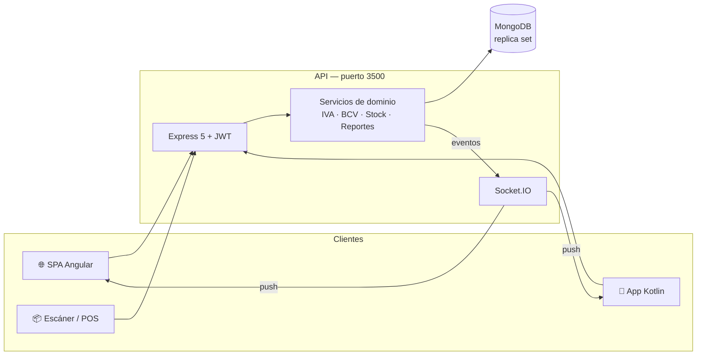

<div align="center">

# 🛒 PymePlus IA

**Plataforma inteligente de gestión comercial para pequeñas y medianas empresas**

API REST + Socket.IO para punto de venta, inventario, clientes y analítica — con reglas fiscales de Venezuela (IVA y tasa BCV) aplicadas desde el primer día.


**[ 🚀 Inicio rápido ](#-inicio-rápido)** · **[ 📡 API ](#-api)** · **[ 🏗️ Arquitectura ](#️-arquitectura)** · **[ 🧪 Pruebas ](#-pruebas)**

</div>

---

## ✨ Qué incluye este repositorio

| Módulo | Estado | Descripción |
|---|---|---|
| 🧾 **Ventas (POS)** | ✅ Listo | Cobro atómico, idempotencia, correlativos, anulación con reversión de stock y factura PDF. |
| 📦 **Productos e inventario** | ✅ Listo | CRUD, códigos de barras, lotes y vencimientos, stock bajo, ajustes auditados. |
| 👥 **Clientes** | ✅ Listo | Identificación RIF/CI/Pasaporte, crédito, estados de cuenta y segmentación. |
| 📊 **Reportes** | ✅ Listo | Ventas, IVA, valoración de inventario, rentabilidad y reposición con exportación PDF/CSV. |
| 💱 **Tasa BCV** | ✅ Listo | Snapshot por venta, detección de tasa obsoleta y fallback explícitamente marcado. |
| 🔐 **Autenticación** | ✅ Listo | JWT + bcryptjs, roles (ADMIN, SUPERVISOR, CASHIER, WAREHOUSE, FINANCE). |
| ⚡ **Tiempo real** | ✅ Listo | Eventos `sale:created` y `stock:updated` vía Socket.IO. |
| 🧪 **Pruebas** | ✅ Listo | Unitarias, smoke HTTP e integración end-to-end con MongoDB en memoria. |
| 🖥️ **Frontend Angular 22** | 🗓️ Planeado | Carpetas reservadas en `/projects/frontend`. |
| 📱 **App móvil Kotlin** | 🗓️ Planeado | Carpetas reservadas en `/projects/mobile`. |

> El código fuente del backend vive en [`projects/backend`](projects/backend/README.md). La documentación funcional está en [`context/`](context/) y las decisiones técnicas en [`memory/`](memory/).

---

## 🏗️ Arquitectura



**Principios aplicados**

- **USD como moneda base**, VES derivado de la tasa BCV y conservado en `rateSnapshot` por venta.
- **Stock nunca se lee y se escribe por separado**: se usa `$inc` con filtro de stock suficiente dentro de transacciones.
- **Errores legibles**: cada falla viaja en un sobre con `userMessage` y `suggestion` para la UI.
- **Idempotencia real**: `X-Idempotency-Key` evita cobrar dos veces si el cliente reintenta.
- **Sin secretos versionados**: solo `.env.example` está en Git.

---

## 📁 Estructura del repositorio

```text
PymePlus-IA/
├── AGENTS.md                    # Guía maestra y protocolo multi-agente
├── context/                     # Contexto de negocio y contratos
│   ├── system_context.md
│   ├── business_rules.md
│   └── api_contracts.md
├── skills/                      # Guías metodológicas (UI/UX, backend, seguridad, testing…)
├── memory/                      # Decisiones de arquitectura y soluciones de errores
├── projects/
│   ├── backend/                 # ✅ API REST + Socket.IO (Node 26 / Express 5 / Mongoose 9)
│   ├── frontend/                # 🗓️ Angular 22 (reservado)
│   └── mobile/                  # 🗓️ Kotlin nativo (reservado)
└── README.md                    # Este archivo
```

---

## 🚀 Inicio rápido

### Requisitos

- **Node.js ≥ 26** (con npm)
- **MongoDB en replica set** — las ventas usan transacciones multi-documento
- Para pruebas de integración no necesitas MongoDB local: se usa `mongodb-memory-server`

### 1. Instalar y configurar

```bash
cd projects/backend
npm install
```

```powershell
# Windows
Copy-Item .env.example .env
```

```bash
# macOS / Linux
cp .env.example .env
```

Edita `.env` con tu `MONGO_URI` y un `JWT_SECRET` largo y aleatorio. **Nunca subas `.env` al repositorio.**

### 2. Cargar datos base (opcional)

```bash
npm run seed
```

Crea el usuario administrador, la tasa BCV y productos de ejemplo.

| Datos iniciales | Valor |
|---|---|
| Usuario | `admin@pymeplus.local` |
| Contraseña | `Admin12345` |
| Tasa BCV | `36` VES/USD |

> ⚠️ Cámbialos antes de exponer el servicio a Internet.

### 3. Arrancar

```bash
npm start
```

```text
Servidor ejecutándose en http://0.0.0.0:3500
Entorno: production · Socket.IO: /socket.io
```

Healthcheck: `GET http://localhost:3500/api/health`

---

## 🔐 Variables de entorno

| Variable | Descripción | Ejemplo |
|---|---|---|
| `PORT` | Puerto HTTP | `3500` |
| `MONGO_URI` | Cadena de conexión (replica set) | `mongodb://localhost:27017/pymeplus?replicaSet=rs0` |
| `JWT_SECRET` | Secreto de firma de tokens | `cambia-esto-por-una-clave-larga` |
| `JWT_EXPIRES_IN` | Vigencia del token | `8h` |
| `FALLBACK_BCV_RATE` | Tasa usada si no hay snapshot vigente | `36` |
| `RATE_MAX_AGE_HOURS` | Antigüedad máxima para cobrar en VES | `48` |
| `VOID_WINDOW_HOURS` | Plazo de anulación sin aprobación | `24` |
| `APP_NAME` | Nombre mostrado en healthcheck y PDF | `PymePlus IA` |

Lista completa en [`projects/backend/.env.example`](projects/backend/.env.example).

---

## 🧪 Pruebas

```bash
cd projects/backend
npm test               # Reglas de negocio (IVA, BCV, validadores, PDF)
npm run test:smoke     # HTTP sin base de datos
npm run test:integration  # End-to-end con MongoDB en memoria
```

| Suite | Resultado | Cubre |
|---|---|---|
| Unitarias | ✅ 11/11 | Redondeo HALF_UP, IVA incluido/exento, RIF/CI, códigos de barras, PDF, timezone. |
| Smoke | ✅ 6/6 | Health, SPA fallback, 404 API, 401 sin token, handshake Socket.IO. |
| Integración | ✅ 14/14 | Login, alta de producto, venta, IVA, idempotencia, anulación, reportes. |

---

## 📡 API

Todas las respuestas usan el sobre:

```json
{
  "success": true,
  "message": "Operación exitosa.",
  "data": {},
  "meta": { "timestamp": "2026-11-23T12:00:00.000-04:00" },
  "errors": []
}
```

### Endpoints principales

| Método | Ruta | Descripción |
|---|---|---|
| `POST` | `/api/auth/login` | Inicio de sesión → JWT |
| `GET` | `/api/products` | Catálogo paginado (búsqueda, stock bajo, vencimientos) |
| `POST` | `/api/sales` | Registrar venta **(requiere `X-Idempotency-Key`)** |
| `POST` | `/api/sales/:id/void` | Anular y restaurar stock |
| `GET` | `/api/reports/sales` | Reporte de ventas |
| `GET` | `/api/reports/:key/export?format=pdf` | Exportar reporte |

Listado completo en el [README del backend](projects/backend/README.md) y contratos detallados en [`context/api_contracts.md`](context/api_contracts.md).

### Ejemplo: registrar una venta

```bash
curl -X POST http://localhost:3500/api/sales \
  -H "Authorization: Bearer <TOKEN>" \
  -H "X-Idempotency-Key: 11111111-1111-4111-8111-111111111111" \
  -H "Content-Type: application/json" \
  -d '{
    "currency": "USD",
    "items": [{ "productId": "<ID>", "quantity": 2 }],
    "payment": { "method": "CASH_USD", "amount": 23.20 }
  }'
```

---

## 🚢 Despliegue

```bash
pm2 start ecosystem.config.cjs --env production
```

Antes de cada actualización en producción, ejecutar el protocolo de respaldo descrito en [`AGENTS.md` §5](AGENTS.md): copia del código + `mongodump`, compilación del frontend y recarga con `pm2 reload ecosystem.config.cjs --env production`.

---

## 🧭 Roadmap

- [x] Backend funcional con API REST y Socket.IO
- [x] Transacciones atómicas de inventario e idempotencia
- [x] Reportes y exportación PDF/CSV
- [x] Pruebas automatizadas y publicación en GitHub
- [ ] SPA en Angular 22 (standalone + signals)
- [ ] App Android en Kotlin nativo (MVVM + Retrofit)
- [ ] Conectores MCP (correo, Telegram, webhooks)
- [ ] Despliegue automatizado con respaldo preventivo

---

<div align="center">

Hecho con ☕ y 🇻🇪 para las PyMEs que venden todos los días.

**PymePlus IA** · [Repositorio](https://github.com/rossellcristinacobis2004-cloud/PymePlus-IA) · [Documentación funcional](context/system_context.md)

</div>
